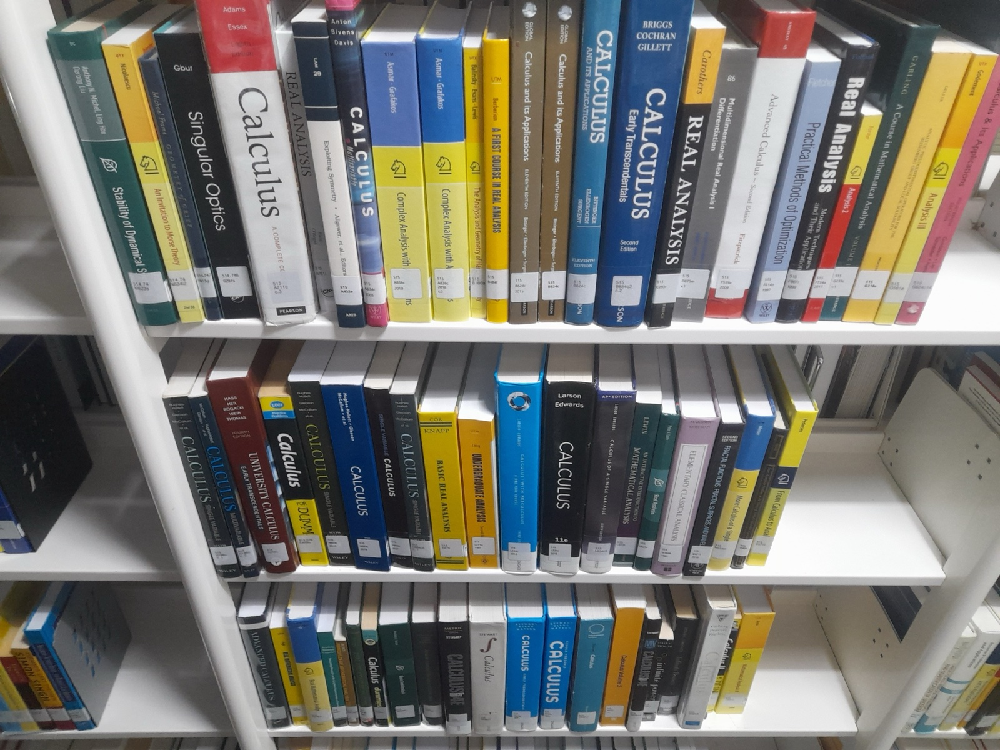
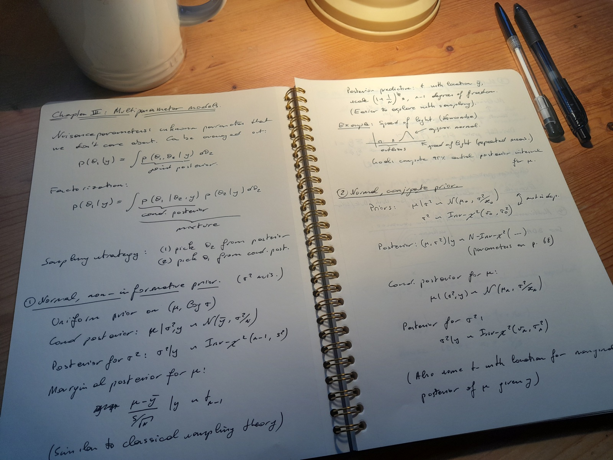
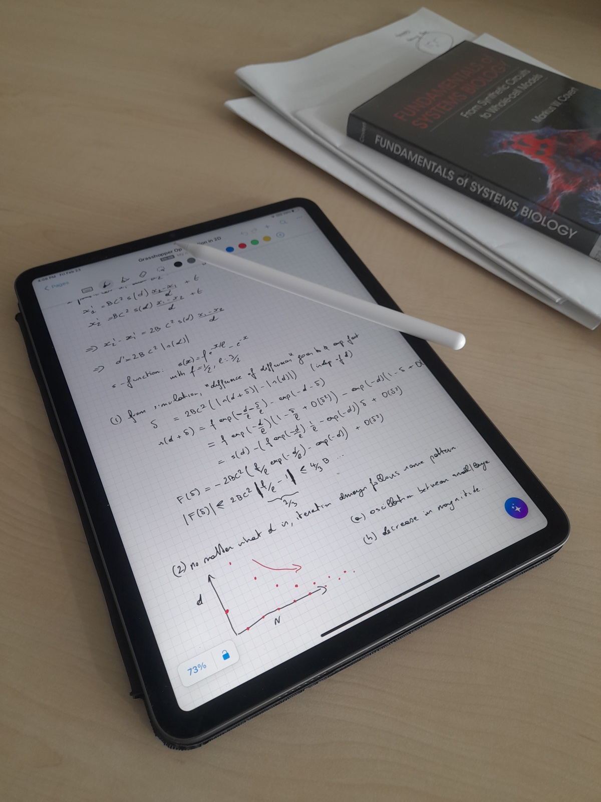
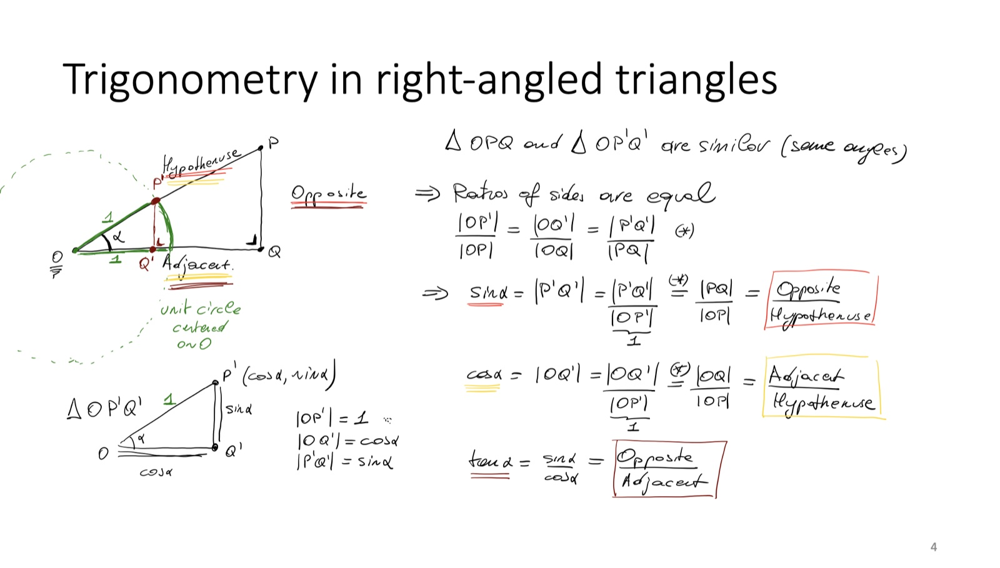
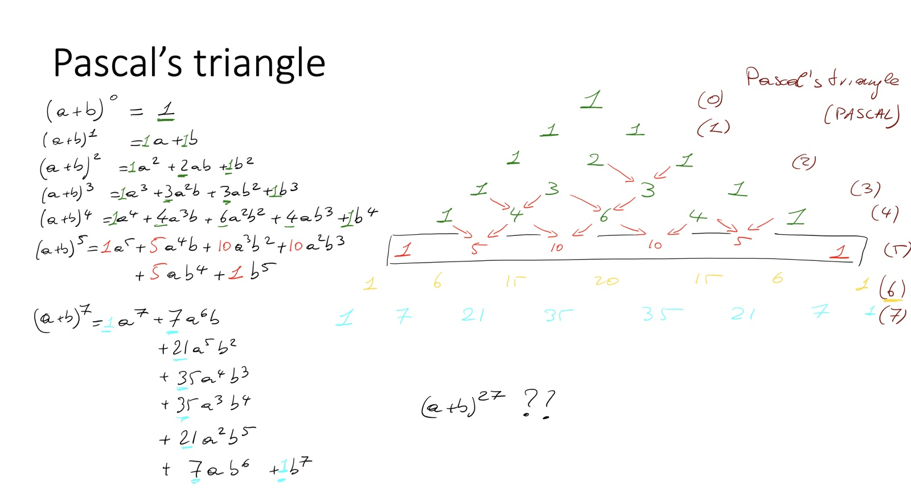
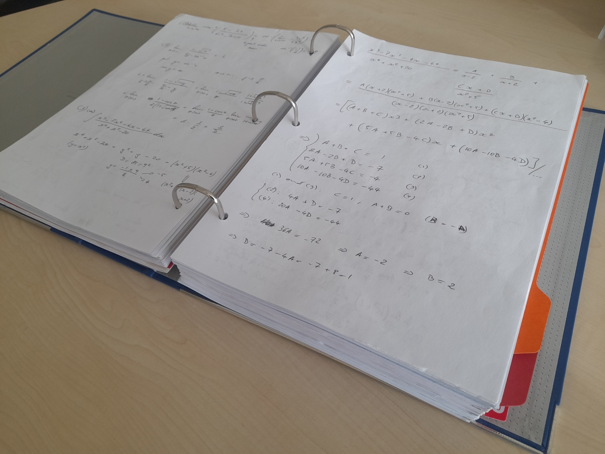
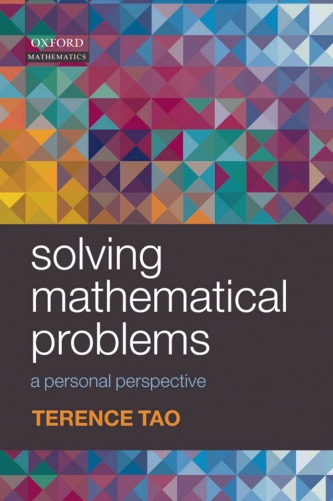
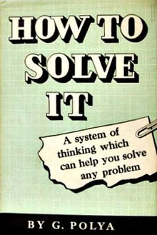
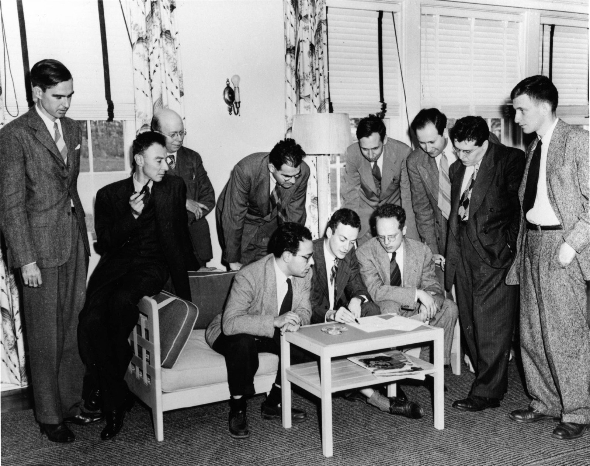

# Practical information

### Course content

```{=latex}
\begin{center}
\begin{tikzpicture}[
    topic/.style={rounded corners=3pt, minimum width=18mm, minimum height=10mm,
                  inner sep=2pt, align=center, font=\scriptsize, text=black},
    path/.style={-{Stealth[length=2mm]}, thick, gray!60}]
  \node[topic, fill=ibmA!30] (t1) at (0,0)     {Trigonometry};
  \node[topic, fill=ibmA!30] (t2) at (2.2,0)   {Coordinate\\geometry};
  \node[topic, fill=ibmB!30] (t3) at (4.4,0)   {Limits \&\\continuity};
  \node[topic, fill=ibmB!30] (t4) at (6.6,0)   {Differential\\calculus};
  \node[topic, fill=ibmC!25] (t5) at (8.8,0)   {Algebra};
  \node[topic, fill=ibmD!25] (t6) at (8.8,-1.5) {Integral\\calculus};
  \node[topic, fill=ibmE!35] (t7) at (6.6,-1.5) {Proof\\techniques};
  \foreach \a/\b in {t1/t2,t2/t3,t3/t4,t4/t5,t5/t6,t6/t7}
    \draw[path] (\a) -- (\b);
\end{tikzpicture}
\end{center}
```

- Some of you may have seen some (or all) of this material before.
- For most of you, however, it will be the first time to see the material in English.
- The way of teaching and examining at GUGC is also different from what you may be used to.

### Course schedule

:::: {.columns}
::: {.column width="50%"}
**Theory lectures**

- Wednesday and Friday, 8:30--9:45
- AB 404, Gh 102

**Exercise sessions**

- Mondays, see schedule
:::
::: {.column width="50%"}
**Ufora** is used for communication:

- Announcements
- Course materials
- Exercises and hints
:::
::::

\vspace{1em}

\begin{alertblock}{Don't miss anything}
Set up Ufora notifications!
\end{alertblock}

### Examination and grading

```{=latex}
\vspace{1em}
\begin{center}
\begin{tikzpicture}[x=5.2mm]
  \fill[ibmA]  (0,0)  rectangle (16,0.8);
  \fill[ibmB]  (16,0) rectangle (19,0.8);
  \fill[ibmE]  (19,0) rectangle (20,0.8);
  \foreach \x in {16,19} \draw[white, thick] (\x,0) -- (\x,0.8);
  \node[white, font=\bfseries] at (8,0.4) {Exam: 80\%};
  \node[white, font=\bfseries\scriptsize] at (17.5,0.4) {15\%};
  \draw[ibmB, thick] (16,-0.1) -- (16,-0.4) -- (19,-0.4) -- (19,-0.1);
  \node[ibmB, font=\scriptsize, below] at (17.5,-0.4) {Quizzes};
  \draw[ibmE!80!black, thick] (19.5,0.9) -- (19.5,1.3);
  \node[ibmE!80!black, font=\scriptsize, above left] at (20,1.3) {Class participation: 5\%};
\end{tikzpicture}
\end{center}
```

\vspace{1em}

- **Exam** (November/December): 80%. Resit exam in February.
- **Quizzes** (3 in total): 15%. Quiz dates are listed in the schedule.
- **Class participation** (9 out of 11): 5%

### Classroom etiquette

- Arrive and be in your seats on time
- Don't leave before the end
- Try not to leave the class during the lecture
  - If you have to leave (e.g. medical emergency), do it discreetly
- Maintain a positive attitude during the lecture

# Information for retaking students

### How to prepare

If you have to retake the class, it is probably because of unfamiliarity with the techniques and the problems.

\begin{block}{Be strategic}
\begin{itemize}
\item Focus on what gave you trouble before
\item Redo the problems, but act like you encounter them for the first time
\item Do new problem sets
\item Reach out for help in a timely manner
\end{itemize}
\end{block}

\vspace{0.5em}

**Use your time wisely.**

### Other sources of problem sets

:::: {.columns}
::: {.column width="55%"}
- Adams and Essex: 7th edition and up
- [Open Source Calculus](https://oscalculusandanalysis.ugent.be/)
- Any other book with the word "Calculus" in the title!
:::
::: {.column width="45%"}
{width=100%}
:::
::::

### Participation score carry-over

:::: {.columns}
::: {.column width="70%"}
- You may choose to carry over your participation score from last semester.
- Use the form listed in the announcement on Ufora before **September 15**:
  [Exemption: practical sessions (2026--27)](https://forms.cloud.microsoft/e/PNRftkYpv0)
- Make sure to study up on the exercises that gave you a hard time!
:::
::: {.column width="30%"}
{width=100%}
:::
::::

\vspace{1em}

\begin{alertblock}{Note}
You must still take part in the quizzes!
\end{alertblock}

# Why study math? How to study math?

###

\begin{center}
\emph{``The book of nature is written in the language of mathematics.''}\\
\hfill -- Galileo Galilei
\end{center}

```{=latex}
\vspace{0.5em}
\begin{center}
\includegraphics[height=2.6cm]{./images/00-introduction/whole-cell-model.jpg}\hspace{1em}%
\includegraphics[height=2.6cm]{./images/00-introduction/cell-signaling.jpg}\\[1em]
\includegraphics[height=2.6cm]{./images/00-introduction/food-web.jpg}\hspace{1em}%
\includegraphics[height=2.6cm]{./images/00-introduction/reaction-network.jpg}
\end{center}
```

### Math courses at GUGC

```{=latex}
\vspace{1em}
\begin{center}
\begin{tikzpicture}[
    course/.style={rounded corners=3pt, minimum width=22mm, minimum height=13mm,
                   text width=20mm, align=center, font=\scriptsize, text=black},
    year/.style={rounded corners=2pt, minimum height=5mm, font=\scriptsize\bfseries, text=white},
    path/.style={-{Stealth[length=2mm]}, thick, gray!60}]
  \node[year, fill=ibmA, minimum width=50mm] at (1.3,1.2) {Prep semester / BA1};
  \node[year, fill=ibmB, minimum width=50mm] at (6.7,1.2) {BA2};
  \node[course, fill=ibmA!25, font=\scriptsize\bfseries] (c0) at (0,0)   {Introduction\\to Engineering\\Math};
  \node[course, fill=ibmA!25] (c1) at (2.6,0)  {Math 1\\\tiny(linear algebra,\\calculus)};
  \node[course, fill=ibmB!25] (c2) at (5.4,0)  {Math 2\\\tiny(multivariate calculus, geometry)};
  \node[course, fill=ibmB!25] (c3) at (8.0,0)  {Math 3\\\tiny(differential equations)};
  \foreach \a/\b in {c0/c1,c1/c2,c2/c3} \draw[path] (\a) -- (\b);
  \node[year, fill=ibmD, minimum width=50mm] at (6.7,-1.4) {BA3};
  \node[rounded corners=3pt, fill=ibmD!20, minimum width=50mm, align=left,
        font=\scriptsize, text=black, anchor=north] (ba3) at (6.7,-1.75)
    {Probability and Statistics\\Process Engineering\\Process Modelling and Control\\\ldots};
  \draw[path] (c3.south) -- (8.0,-1.15);
\end{tikzpicture}
\end{center}
```

### How to study math?

:::: {.columns}
::: {.column width="55%"}
**Three essential steps**

```{=latex}
\vspace{0.5em}
\begin{tikzpicture}[
    num/.style={circle, minimum size=7mm, font=\bfseries, text=white},
    lbl/.style={anchor=west, font=\small}]
  \node[num, fill=ibmA] (s1) at (0,0)    {1};
  \node[num, fill=ibmB] (s2) at (0,-1.2) {2};
  \node[num, fill=ibmC] (s3) at (0,-2.4) {3};
  \node[lbl] at (0.5,0)    {Take notes in class};
  \node[lbl] at (0.5,-1.2) {Solve problems on your own};
  \node[lbl] at (0.5,-2.4) {Critically evaluate your progress};
\end{tikzpicture}
```
:::
::: {.column width="45%"}
{width=100%}
:::
::::

### Why write by hand?

- Writing by hand forces me and you to go slow.
- Paper notebook/tablet is OK
- **Don't take notes on a laptop**

\vspace{0.5em}

:::: {.columns}
::: {.column width="50%"}
{height=42%}
:::
::: {.column width="50%"}
{height=42%}
:::
::::

\tiny Source: \href{https://stackoverflow.blog/2022/11/23/why-writing-by-hand-is-still-the-best-way-to-retain-information/}{Why writing by hand is still the best way to retain information}

### What should you note down?

:::: {.columns}
::: {.column width="55%"}
**In theory class:**

- Not everything is on the slides
- I will write on the tablet, you take notes
- You should be able to reconstruct proofs, solutions, ... from your notes

**In practice class:**

- Compare your solution with the model
- Correct wherever necessary (in a different color)
:::
::: {.column width="45%"}
\centering\scriptsize Example lecture slides

{width=100%}

{width=100%}
:::
::::

### How to solve problems?

:::: {.columns}
::: {.column width="60%"}
- Do the homework problems ahead of the practical session
- Don't be afraid to spend a lot of time, especially in the beginning
- Evaluate:
  - Was it easy?
  - Did I make many mistakes?
  - Do I feel confident?
:::
::: {.column width="40%"}
{width=100%}
:::
::::

\vspace{1em}

\begin{center}
\emph{Problems worthy of attack\\prove their worth by fighting back.}\\
{\small -- Piet Hein}
\end{center}

### How to prepare for problem solving

:::: {.columns}
::: {.column width="65%"}
- Put aside some regular time (e.g. 1 hour per day, before class)
- A little bit every day is better than a lot once per week
- Put away your phone, turn off the TV. It's just you and the problem.
:::
::: {.column width="35%"}
{width=90%}
:::
::::

### Problem solving heuristics

:::: {.columns}
::: {.column width="70%"}
\small

- Have you seen it before? Or have you seen the same problem in a slightly different form?
- Do you know a related problem? Do you know a method that could be useful?
- Could you restate the problem? Could you restate it still differently? Go back to theory concepts.
- If you cannot solve the proposed problem, try to solve first some related problem. Could you imagine a more accessible related problem? Could you solve a part of the problem? Keep only a part of the condition, drop the other part; how far can you get?
:::
::: {.column width="30%"}
{width=100%}
:::
::::

\tiny Source: \url{https://www.cs.yale.edu/homes/aspnes/pinewiki/ProblemSolvingTechniques.html}

### Feynman's problem solving algorithm

:::: {.columns}
::: {.column width="45%"}
1. Write down the problem.
2. Think very hard.
3. Write down the solution.
:::
::: {.column width="55%"}
{width=100%}
:::
::::

### How to make progress?

:::: {.columns}
::: {.column width="50%"}
\begin{block}{When it's too difficult}
\emph{``The journey of a 1000 miles starts with a single step.''}
\begin{itemize}
\item Start with an easier problem.
\item Review the model solutions from the theory lecture.
\item Ask for help.
\end{itemize}
\end{block}
:::
::: {.column width="50%"}
\begin{exampleblock}{When it's too easy}
Pick a harder problem! Don't waste your energy on simple problems!
\end{exampleblock}
:::
::::

### What problem sets do we offer?

```{=latex}
\vspace{1em}
\begin{center}
\begin{tikzpicture}[
    card/.style={rounded corners=4pt, minimum width=33mm, minimum height=26mm,
                 text width=30mm, align=center, text=black}]
  \node[card, fill=ibmA!20] at (0,0)
    {\textbf{Homework problems}\\[4pt]\scriptsize Designed to give you practice.
     Can you use the techniques?};
  \node[card, fill=ibmB!20] at (3.8,0)
    {\textbf{Exam problems}\\[4pt]\scriptsize Harder, designed to make you think.};
  \node[card, fill=ibmC!20] at (7.6,0)
    {\textbf{Sample exams}\\[4pt]\scriptsize Hard: exams from previous years.};
  \draw[-{Stealth[length=3mm]}, thick, gray!60] (-1.5,-1.7) -- node[below, font=\scriptsize] {increasing difficulty} (9.1,-1.7);
\end{tikzpicture}
\end{center}
```

\vspace{1em}

You will find all these on Ufora.

### How to ask for help?

**Don't wait too long!**

- After class: for small things that weren't clear
- During practical sessions: for help with specific problems
- Via email or in-office appointment: for bigger issues

For in-office meetings, make an appointment.

\begin{block}{Show us that you've done the work!}
\begin{itemize}
\item Useful to help us give you specific feedback
\item Partial credit on the exam: the final answer is not enough!
\end{itemize}
\end{block}

### How to ask for constructive feedback?

\begin{alertblock}{\no\ Don'ts}
\begin{itemize}
\item ``I don't understand the course. Please explain $\langle$huge topic from 3 months ago$\rangle$.''
\item ``Please send me the solution for problem X.''
\end{itemize}
\end{alertblock}

\vspace{0.5em}

\begin{block}{\yes\ Do's}
\begin{itemize}
\item ``I am stuck on problem X. I have tried A, B, and C, but I cannot continue because of Y.''
\item ``Here is my solution for problem X. Can you tell me where I went wrong?''
\end{itemize}
\end{block}

### How hard is the class?

- Passing rate for this class: **40%--45%**
- I want this number to be higher
- I will not decrease standards -- this is GUGC
- I and the TAs are ready to help you with the class.

\vspace{0.5em}

\begin{center}
\emph{``\ldots 50\% pass rate in the first year \ldots''}
\end{center}

\vspace{0.5em}

\begin{exampleblock}{}
\centering
It is \textbf{NOT HARD} if you keep on top of things!
\end{exampleblock}
